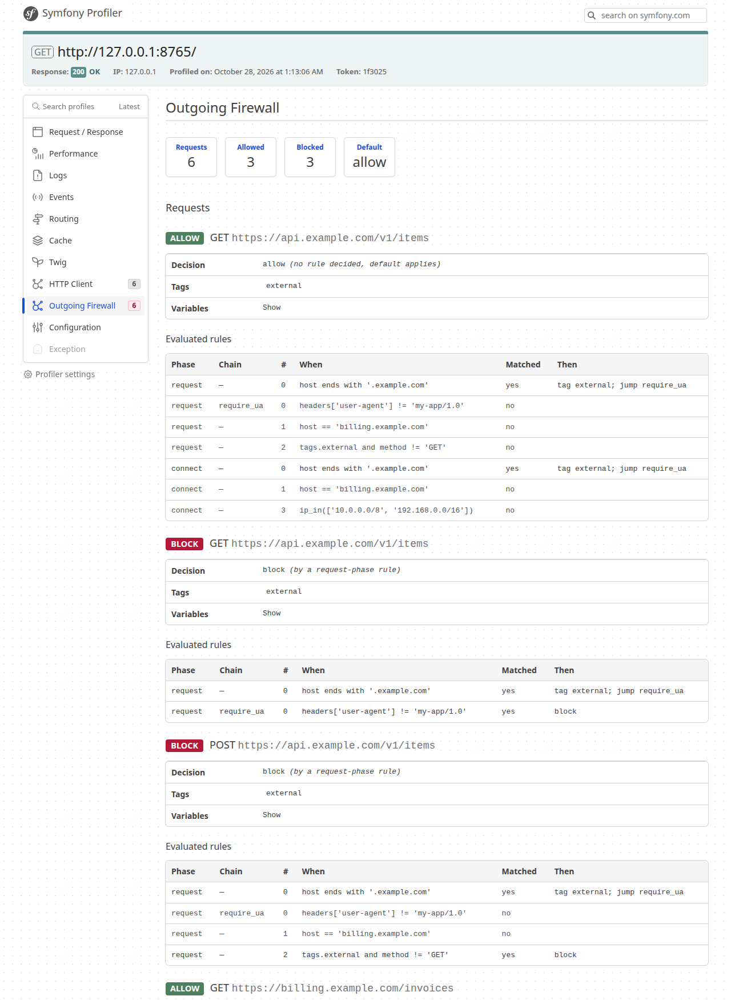

# Symfony Outgoing Firewall

A rule-based firewall for outgoing requests made through Symfony's `HttpClientInterface`, configured somewhat like `access_control` for incoming ones: ordered rules, expressions, first match wins.

```yaml
# config/packages/outgoing_firewall.yaml
outgoing_firewall:
    default: allow
    chains:
        require_ua:
            - { if: "headers['user-agent'] != 'my-app/1.0'", action: block }
        weekdays_only:
            - { if: "weekday in ['Sat', 'Sun']", action: block }
    rules:
        - { if: "host ends with '.example.com'", tag: external, jump: require_ua }
        - { if: "host == 'billing.example.com'", jump: weekdays_only }
        - { if: "tags.external and method != 'GET'", action: block }
        - { if: "ip_in(['10.0.0.0/8', '192.168.0.0/16'])", action: block, phase: connect }
```

A blocked request throws `Valtzu\OutgoingFirewall\Http\RequestBlockedException` (a `TransportExceptionInterface`) naming the rule that blocked it.

## Purpose

This is a guard rail, **not a security boundary**.

It exists so that you don't shoot yourself in the foot: a staging deploy calling the production payment API, a test run hitting a real third party, a job talking to the wrong environment, a feature that must only run on weekdays. It protects against accidental cross-environment calls made by code you own.

It does **not** try to stop an attacker or a compromised vendor package from reaching something. Code that uses Guzzle, `curl_*`, `file_get_contents()` or a sockets directly never passes through Symfony's `HttpClientInterface`, so it is not seen. If you need real egress control, enforce it outside PHP (network policy, egress proxy, container or firewall rules).

## Installation

```
composer require valtzu/symfony-outgoing-firewall
```

Register the bundle if Flex did not:

```php
// config/bundles.php
Valtzu\OutgoingFirewall\ValtzuOutgoingFirewallBundle::class => ['all' => true],
```

By default the firewall decorates `http_client.transport`, the service every FrameworkBundle client ends up in (`http_client` and all `scoped_clients`). Because scoped clients merge their own options before reaching it, the rules see their headers and resolved URLs. Use `transports` to protect other services:

```yaml
outgoing_firewall:
    transports: [http_client.transport, my_custom_client]
```

## Rules

Rules run top to bottom. The first rule that decides (`action: allow` or `action: block`) wins. When none does, `default` applies.

A rule has a condition, `if`, and effects. The condition says when the rule applies, the effects say what happens then:

| Key      | Kind | Meaning |
|----------|------|---------|
| `if`     | condition | When the rule applies: an expression or a map of matchers, see below. Omit it to always apply. |
| `action` | effect | `allow` or `block` decide the request. `log` flags it for the log and the profiler, then evaluation continues. |
| `tag`    | effect | A tag, or a list of tags, to put on the request. |
| `jump`   | effect | A chain, or a list of chains, to evaluate. |
| `phase`  | | `request` (default) or `connect`, see below. |

A rule needs at least one effect. When a rule applies, it first adds its tags, then runs its jumps, then applies its action.

### Conditions

`if` is an [expression](https://symfony.com/doc/current/reference/formats/expression_language.html), or a map of matchers for the common exact matches. These two rules are the same:

```yaml
- { if: { host: foo.com, path: /bar }, action: block }
- { if: "host == 'foo.com' and path == '/bar'", action: block }
```

| Matcher | Matches |
|---------|---------|
| `method`, `scheme`, `host`, `port`, `path` | The variable of the same name, exactly |
| `tags` | The request carries the tag, see `tag` above |
| `expression` | An expression, to combine with the matchers above |

All matchers in the map must hold. A list means "any of": `method: [POST, DELETE]` is `method in ['POST', 'DELETE']`, and `tags: [a, b]` needs one of the two tags. Method, scheme and host are compared case-insensitively. The profiler shows the compiled expression.

```yaml
# tag a request, then act on the tag further down
- { if: { host: [api.example.com, billing.example.com] }, tag: external }
- { if: { tags: external, expression: "weekday in ['Sat', 'Sun']" }, action: block }
```

In an expression, a tag is `tags.name` (or `tags['my-tag']`), which is `false` for any tag not set. A literal `%` in an expression must be written `%%`, as in any container parameter.

### Variables

| Name | Value |
|------|-------|
| `method`, `url` | Method and the full resolved URL |
| `scheme`, `host`, `port`, `path`, `query` | Parts of the resolved URL. `host` is lowercase. |
| `tags` | Tags set by earlier rules: `tags.name` is `true` or `false` |
| `headers` | Request headers, read as `headers['User-Agent']`: case-insensitive, several values joined with `, `, `null` when absent. Includes headers from `default_options`, scoped clients and `withOptions()`. |
| `now`, `weekday`, `hour` | Current time (from the `clock` service), `Mon`..`Sun`, `0`..`23` |
| `ip`, `connect_time` | Peer IP and connect time in seconds, `null` until the connection is made (connect phase) |

### Functions

| Name | Value |
|------|-------|
| `ip_in(ranges)` | Whether `ip` is in a CIDR range or a list of them |

Everything else from Symfony's ExpressionLanguage is available (`matches`, `in`, `starts with`, `ends with`, `contains`, `now.format('H')`, ...).

## Chains

A chain is a named list of rules, so that several hosts can share one set without repeating it. `jump` evaluates a chain. If a rule inside it decides, that decides the request. If nothing in it decides, evaluation continues after the `jump` rule (like `RETURN` in iptables). Chains may jump to other chains. Unknown chains and cycles fail when the container is built.

```yaml
outgoing_firewall:
    chains:
        business_hours:
            - { if: "weekday in ['Sat', 'Sun']", action: block }
            - { if: "hour < 8 or hour >= 18", action: block }
    rules:
        - { if: "host == 'api.example.com'", jump: [business_hours] }
        - { if: "host == 'billing.example.com'", jump: [business_hours] }
```

A chain can also be written with a `phase` that all its rules inherit:

```yaml
chains:
    no_private_ips:
        phase: connect
        rules:
            - { if: "ip_in('10.0.0.0/8')", action: block }
```

## Phases

Most rules only need what is known before sending: URL, headers, time. These run in the `request` phase and block by throwing from `request()`.

The peer IP and the connect time are only known once the connection is made. Rules with `phase: connect` run once, from the client's `on_progress` callback, when the transport first reports the peer IP. The callback is installed only when at least one connect rule exists, and any `on_progress` you pass is still called.

Things to know:

- A connect-phase block aborts the transfer, and the exception comes out when the response is consumed (`getStatusCode()`, `getContent()`), not from `request()`.
- The connection is already open then, so the request may already have been sent. Use the request phase for anything that must not leave your process.
- `jump` rules without an explicit `phase` run in both phases, so a jump into a connect chain works from a top-level rule.
- `connect_time` is reported by the curl transport only. With the native transport it stays `null`.
- If the transport never reports a peer IP (`MockHttpClient` for instance), connect rules never run. That includes `default: block`.

## Logging

Blocked requests are logged at `warning`, and requests that matched an `action: log` rule at `info`. Both go to the `outgoing_firewall` channel, with the method, the URL without its query string, the tags and, for blocks, the rule that decided. Allowed requests are not logged unless a rule says `log`, so this is cheap to leave on in production.

```yaml
# config/packages/monolog.yaml
monolog:
    handlers:
        outgoing_firewall:
            type: stream
            path: '%kernel.logs_dir%/outgoing_firewall.log'
            level: info
            channels: [outgoing_firewall]
```

A rule that only watches, without changing the outcome:

```yaml
- { if: { host: api.payments.example }, action: log }
```

## Profiler

With `symfony/web-profiler-bundle` and `kernel.debug`, the toolbar shows how many requests were blocked or logged. The panel lists those requests, the rules evaluated for each, which ones matched, the tags collected and the variables. Allowed requests are left out, to keep the panel readable. Add `action: log` to a rule to see its requests here as well.




## Extending

Add variables by implementing `VariableProviderInterface` and tagging the service `outgoing_firewall.variable_provider` (autoconfigure is not enabled for it):

```php
final class DeploymentVariables implements VariableProviderInterface
{
    public function getVariables(): array
    {
        return ['env' => $_SERVER['APP_ENV']];
    }
}
```

```yaml
- { if: "env != 'prod' and host == 'api.payments.example'", action: block }
```

Add functions with Symfony's `ExpressionFunctionProviderInterface`, tagged `outgoing_firewall.expression_function_provider`.

## Testing

```
composer install
vendor/bin/phpunit
```

## License

MIT. The profiler icon is from [Tabler Icons](https://tabler.io/icons) (MIT).
